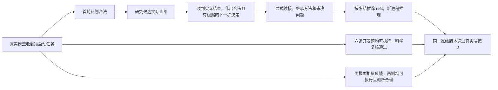

# 真实 LLM 决策验收进度与下一轮修改方案

**提交所有者审核，2026-11-24。** 基线为 `feat/mission-research-v2`，Git HEAD 为 `079362ce`，最终独立复测的工作区源码身份为 `8a82fe7cdb147a3b935d151162acc18bc7972d3b36b433c6168eba38a5c81aa2`。本稿是待批修改与验收方案。实施应先核对实际工作区差异。工程已经限定通过，真实多轮研究 B 尚未通过。

## 一、距离目标有多远

一条完整研究要沿上轨走通，独立判断题要沿下轨走通。两轨使用同一冻结版本；两轨合起来构成项目约定的 B 验收。

| 冻结批次 | 真实父研究到达的节点 | 六题 / 配对严格可执行数 |
|---|---|---|
| 11/20 第二版 | 一项特征候选四折训练完成；第二轮读到了变差的结果，提出换窗，但错绑依据，也讲错了窗口长度，计划被拒 | 0/6，0/2 |
| 11/23 综合证据版 | 首规划遗漏被选来源对应的事实，研究候选为零 | 5/6，1/2 |
| 11/23 依据绑定版 | 训练来源挂到了诊断槽，研究候选为零 | 2/6，1/2 |
| 11/24 批次实验计划首批 | 同一父方案下，两项候选各完成四折；第二轮实际结果已组成请求，在本地构造 Provider 格式时失败 | 六题只有一份完整原答，结构有效；另有一次投递未知，四题未发。配对未发 |
| 11/24 修补后独立复测 | 9/9 返回完整原答。新父首规划因证据关系不全被拒，16 次拟合全属起点及对照 | **5/6，1/2** |

其他历史路径也有参考意义。11/20 第三版父研究做了两次规划并停止，子研究读到父历史，却因首答超长被拒；该批没有实际训练研究候选。离线预写答复驱动的 worker 已能跑父子研究、显式 refit 和新进程推理。上述记录证明各环节具备部分能力，不能拼成最终版本的一次完整真实研究。新旧任务和部分底模也有区别，表中数字不构成受控改版效果估计。

**距离可以落到三项待证结果。** 最终版还要在一条父研究上稳定提出并执行合法实验，按该实验的实际结果作出合格决定；从该研究续接并完成可信交付；在同版六题及相反反馈两侧同时满足执行和科学标准。当前能定位的是一个集中修补包，不能从一次首答、两个配对成员或工程通过数推出还需几版、通过概率或完成百分比。

依据见[实现时间线](docs/CURRENT_IMPLEMENTATION.md)、[首批收据](docs/validation/decision_batch_20261124.json)、[最终复测收据](docs/validation/decision_batch_retest_20261124.json)及[预登记 B 判据](.decision-batch-retest-20261124/B_RUBRIC_PRELIVE.json)。

## 二、研究中的关系怎么设计

| 关系 | 建议语义 | 产品中的例子 |
|---|---|---|
| 一个命题 → 多项实验 | 可跨批次持续，先取线索，再做能改变判断的干预 | 先查两特征训练期相关，再以同数据、模型、窗口和目标日期做删项比较 |
| 一项实验 → 一个主要问题 | 单次行动通常选一个直接检验命题，实验前就能讲清观测量及方向 | “只删除平滑因子后，总体开发 MAE 会下降吗？” |
| 一项实验 → 多个直接命题 | 只有同一已声明对照及实际输出确实能区分这些预测时才共同登记。多个命题可以竞争，也可以同时成立 | 同一次删项比较可检验“删除后变好”和“删除后变差”。小差异或分折不一致可能让判断保留未决 |
| 一个结果 → 多个认识更新 | 可分别影响不同版本的判断；引用同一次预测和同一批日期仍是一份来源 | 删后变差削弱“应删除”的预期；高相关这一观察仍成立，变差的机制仍开放 |

**整体为有界多对多。** 方法沿父候选继承；研究认识沿问题、确切命题版本和证据延续，两者都应保留。动机、直接检验、结果出来后的解释分属三个时点。单轴指相对实际父方案只改一个方法轴，不限定只能讨论一个命题。一个实验同时加两个特征可以测组合效果，不能据此分配各自的贡献。

**现有实现已支持这组基数。** 常规诊断或训练行动须选至少一个、最多三个确切命题版本，同一版本可以在后续行动继续使用。程序把行动直接依赖、查询依赖、所选实验来源关联的事实汇总，逐一核对每个被测命题，并检查该版本已有的支持、反证和待办。既有有效判断可复用，本轮可明确评估或有依据地暂缓。未被本行动选中的其他假设仍保留在研究状态。已有 `drives` 可表达促使采取行动的观察。见[批次表达](src/finance_forecast_agent/decision_batch.py)、[来源映射](src/finance_forecast_agent/decision_action_basis.py)、[观察推动行动](src/finance_forecast_agent/decision_slots.py)与[最终办理门禁](src/finance_forecast_agent/research_state.py)。

## 三、下一版只改一个包

**修改目标是让模型能用一次答复表达已经作出的科学选择，并在发出前看懂该选择的证据责任。** 正式产品沿用原控制器、预算、批前冻结、单轴执行、原子校验、推荐与交付。新增表达按显式请求版本启用，保留旧请求、历史哈希和 Replay；正式 UI 复用当前批次实验计划的入口。

### 1. 把“为何想到做”和“本实验直接测什么”放在正确位置

- 在行动设计里把现有被测版本列表显示为“直接检验”，默认示例给一个 H；不预选、不自动删掉第二个 H，也不增加一份平行的主假设 ID。沿用既有研究问题、每项行动的预期/反证/分支和逐 H 的 `drives`。次要线索可以促使采取行动，也可以留在开放问题里。
- 当同一行动真的直接检验多个 H，须从已有命题、实际测量和事前分支看出每个 H 如何受结果影响。一个实验仍只占一次执行、一次计算成本；分组问题必须有对应输出、对象和参照。只有总体 MAE 的实验不足以办理“高波动组受害”。科学语义由原答评阅，程序只对可确定的身份、能力和范围负责。
- 训练行动选来源，诊断选测量、对象与事实依赖。复用当前投影，把 `E → F`、各 H 已办理/待办理的事实、确切旧版和剩余容量紧邻呈现。用原父失败样本具体说明：A1 的来源 E7 引出 F1；如果直接测 H1，就要表达 H1 对 F1 的判断，亦可说明该事实不足以区分解释。即使从 A1 移除 H2，H1 缺 F1 仍须拒绝。如果保留两项直接检验，H2 对行动直接依赖 F14 的缺口也须办理。程序可列出缺失的槽、H 和 F，不能生成科学判断、替模型删来源或静默降级为“暂缓”。
- 预检及错误解释从现有依赖计算共享同一逻辑，防止提示和执行器各算一套。答复前只呈现可选来源及条件义务；待模型作出选择，才有实际依赖集合。所有必办反证保留到当前版本或续接，不能通过少选 H 删除历史。原子拒绝、一次答复和两次规划的预算继续有效。

### 2. 减少建立/修订命题时的机械遗漏

- 新建命题沿用一次声明，要求问题、可检验主张、条件、合理竞争解释及原合同的状态等字段。将“另一种也能解释这一观察的情况”紧邻主张，由模型写；缺失时保留原拒绝。
- 修订以确切可见旧版本为操作目标。建议新表达复用仓库已有的**以目标句柄为键**的修订形式，值只写变化后的内容及新版本别名；由同一次选择机械编译为原 `from`。旧版本存在多个或来源不明时拒绝。相同主张只改变证据强弱时走既有评定，不创建新版。两种情况都保留形成时点和旧判断。
- 新接口只给一种合法修订写法；选自当前请求允许的句柄，保留原长度、容量及严格本地语义校验。顶层百炼结构约束沿用已验证的子集，更深约束交给同一个本地编译器。用实际物理请求检验压缩和未压缩表单、旧版本解码，以及最密批间输入和合法短答的输出空间。

### 3. 把判断和采用分开，验证“这一步能学到什么”

沿用原判断与实验分支，只需能读出三件事：实际测到了什么，对具体命题意味着什么，哪种新结果值得消耗下一槽。总体 MAE、逐折方向、作用范围、来源和冻结采用规则由程序给出。机制、替代解释、继续或停止由模型决定。相同预测上的相同观察不能算新证据；同一预测上全新且可回答的分组或尾部统计可以有价值。身份、目标日期、掩码和已展示的统计量都相同时方可判重复，不能仅按模型名或总体 MAE 相等判重复。

举例：训练期测出两个特征高度相关，模型可以认可“在这些折内高度相关”，同时将“高度相关导致预测差”保留为未决。下一批只删除其中一个合法生成特征，固定其余方法。若总体变差 3.02%、四折中一折反向，应削弱“删除会改善”的具体预测。仍需保留分折差异，以及正则化、样本差异等竞争解释。若各组损失已知，再查同一张表不会改变行动；若组内效果确实未测且有助决定下一步，可做有界诊断；也可在预算下合理停止。采用政策独立执行。

## 四、实施和验收顺序

| 批次 | 实施 / 检查 | 退出条件 |
|---|---|---|
| A　固定失败 | 从最终复测抽取父首答、缺竞争解释的开发题、缺修订来源的配对题。另取 11/20 第二轮错绑反证和 11/24 首批合格计划。保存请求、原答、版本、具体错误和运行成本 | 旧解码器原样复现三份拒绝和旧合格计划；逐项指出缺失关系。历史答案只作回归 |
| B　修作者接口 | 实施上述三处，复用已有状态归约与校验；手写独立的合法正例、近似错例和边界案例，覆盖单测、共测、跨轮、停止、修订与来源 | 正例全链编译，负例仍原子拒绝；错误精准到相关字段/槽位。对仅更换展示表达的等价计划，比对父方案、轴、所测版本、事实和预算完全相同。不靠改历史 fixture 消除失败 |
| C　工程闭环 | 合成数据经正常入口跑真实 worker。冷启动→候选四折训练→批间更新→显式续接继承未决→按冻结推荐 refit→新进程无标签推理。测试停止、恢复、缓存与子任务预算；冻结实际源码、依赖和输入后跑适用回归、串行浏览器、静态检查 | 留实际计划、fit 次数、训练行范围、因果可见的证据、结果来源、推荐及模型包引用。无隐藏拟合或新增 Provider 调用。失败保留原始 exit，修后冻结并重跑受影响门禁 |
| D　一次正式真实验收 | 仅在新授权和当日免费保护有效后，对最终冻结源码运行新的合成父任务、显式子任务、六道原判据开发场景及一组新相反反馈。先看真实研究，再独立评题。完整地比较配对两侧，不向模型传答案或另一侧结果 | 父候选实际训练；实际反馈进入决策，正确处理方向/反向折/限度并选合法、有信息价值的行动或合理停止；子研究继承；冻结推荐 refit 和新进程推理真实完成；六题均严格有效且无实质科学错误；同模型同配置配对两侧严格有效且解释响应证据。缺项按实际失败或未运行记录，不跨版本累计 |

验收必须包含以下容易漏掉的反例：

1. 单 H 仍漏掉所选来源映射到的 F；两 H 只办理了一侧；旧 H 的反证在续接中仍待办。三者均不能被界面简化放行。
2. 同一删项实验检验两个真实竞争预测，先有效形成两条命题，事后两个命题都能更新；只执行一次，反向解读同一比较不产生第二份证据。一个命题也能依次接受相关诊断和真正的删项干预。
3. 同条件且同快照，相反结果应使具体预测的判断相应变化。行动可以相同，例如两侧都查尚未测得的分组损失，但理由须承接各自方向。只按 `weakened` 等标签计分不能通过。
4. 预测“删后不明显变差”与“删后将明显改善”分别预先写出方向和幅度；近零差的解释不能互换。低 Pearson 情形利用已知平方构造；微弱非零 Spearman 本身不能证成机制。
5. 仅有一折统计、数据不足、对照相同、工具不能取得所需量，允许暂缓、合理停止或请求复核；既有冻结政策不被额外子组条件覆盖。部分失败和保守回退不能算成功。
6. 旧协议、旧模型包、显式父控制与冻结推荐、历史哈希、部分运行恢复分别验证；原停止/复核没有额外强制实验。请求超长、无效版本、投递未知等按原预算和停止规则记账。

**拟申请的 Live 边界**：一版，一批，只发合成白名单。父最多两次规划、子最多两次、六题及配对两侧共八次，按完整路径预留最多 12 个逻辑请求，建议实际 HTTP 上限 14，单请求一次、4,096 输出 token、180 秒，父子各至多 32 次 fit，另最多一次显式 refit，总计最多 65。原五款按批准顺序、关闭思考、免费硬停，仅按批准的额度事件顺延。配对若跨底模，记录不可比；投递未知或其他全局停止条件封存。六道反复使用的题标为开发回归。保存每题原文、代码版本、HTTP、拟合、退出码和语义评语。上批剩余额度不结转。本方案审核不启动调用。

## 五、对抗性审查与路线

| 可能制造的假改善 | 已纳入本稿的修正 |
|---|---|
| 强制一对一，一条共同证据要跑两遍 | 保留原有界多对多，默认一个直接目标，真正的联合检验可声明多个 |
| 仅删掉错挂的 H 就让原计划过 | 孤立地验证 E7→F1 缺口；同一门禁继续核对每个被测版本的全部真实依赖 |
| 自动把相关性标成支持、替模型补来源或竞争解释 | 只绑定确定性身份、呈现待办；缺少科学内容整批拒绝 |
| 只修缺字段，六题结构全绿就宣告完成 | 原始回复另做科学审查，并要求同版真实 worker、续接、refit 与推理 |
| 为拿到赢家而重开研究、强制两侧选不同动作 | 验收看反证处理和行动价值，允许保留起点、停止及机制未决 |
| 再造一套证据关系、预审代理或复杂调度平台 | 沿用现有绑定、开放问题、预算和状态。每个决策只调用一次，不加自动纠错与反思调用 |

**建议本次只批准此修改包与离线验收范围，真实验收资源按上段单列批准。** 正式迭代顺序保持“决策与现有核心工具联合收口 → 同源真实行为 B → 所有者复核 → 限定用户试用”。窗口、生成特征、登记模型继续作为可用操作；本轮不扩模型族、优化器或跨项目记忆。若 B 未通过，报告第一个阻断点、它的原始事实及其他独立项目实际覆盖，不自动追加版本、换模型求通过或重写路线。

批准后将实施条款写入现有 [ER](docs/EVIDENCE_RESEARCH_LOOP.md)；在架构和验收文档更新关系示例与门禁，handoff 记录测试入口；用户指南更新操作含义；[Current](docs/CURRENT_IMPLEMENTATION.md) 只写实际验证结果。[正式路线](docs/PROJECT_ROADMAP.md) 只需在当前里程碑澄清退出判据，无需新里程碑、ADR 或另一份长期路线。研究选择是否优于简单策略、独立预测效果和真人复核另行评价。
